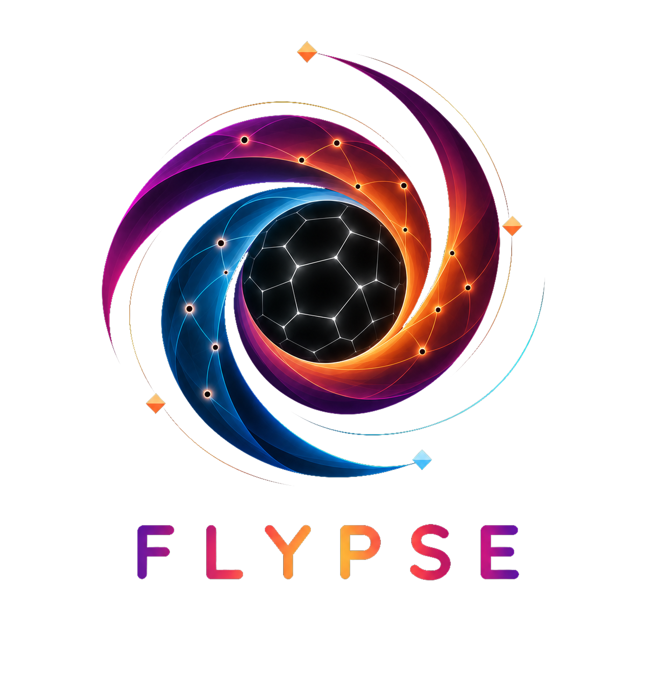

<p align="center">
<picture>
    <source media="(prefers-color-scheme: dark)" srcset="https://raw.githubusercontent.com/eclypse-org/flypse/refs/heads/main/docs/_static/images/dark/transparent.png">
</picture>
</p>


[](https://github.com/pre-commit/pre-commit)
[](https://codecov.io/github/eclypse-org/flypse)
[](https://results.pre-commit.ci/latest/github/eclypse-org/flypse/main)

**FLYPSE** is a Python library for experimenting with federated learning on the cloud–edge continuum. Write what each participant does, connect the participants in any topology, place them on an infrastructure, and study how learning behaves as data, devices and links differ and change.

FLYPSE is designed for researchers and developers evaluating federated protocols under realistic systems: synchronous or asynchronous, centralised, hierarchical or decentralised. It builds on [ECLYPSE](https://github.com/eclypse-org/eclypse), which places and emulates the participants.

## Key features

- **Write the protocol, not a plugin:** a participant is an [entity](https://flypse.readthedocs.io/en/latest/overview/concepts/entities/) with a `step`, which sends and receives models. There is no round loop, no role and no barrier in the core: rounds, deadlines, buffers and gossip are what the entities do.
- **Connect any topology:** build [federations](https://flypse.readthedocs.io/en/latest/overview/concepts/federation/) as stars, trees, rings or custom graphs, and let entities ask who their parent, children and neighbours are.
- **Pay for communication:** each [message](https://flypse.readthedocs.io/en/latest/overview/concepts/messaging/) really takes as long as its size costs over the latency, bandwidth and processing time of every hop of its route.
- **Model heterogeneity:** split data with [label or quantity skew](https://flypse.readthedocs.io/en/latest/overview/concepts/data/), and change devices and links [while the federation runs](https://flypse.readthedocs.io/en/latest/overview/advanced/heterogeneity/).
- **Bring any model:** [models](https://flypse.readthedocs.io/en/latest/overview/concepts/models/) of any framework are exchanged as flat numpy vectors, with versions that tell where each one comes from.
- **Compose strategies:** select, screen, weigh, aggregate and optimise with [functions and small classes](https://flypse.readthedocs.io/en/latest/overview/strategies/) on those vectors, from federated averaging to Byzantine-robust and personalised aggregation.
- **Inspect results:** entities [report](https://flypse.readthedocs.io/en/latest/overview/advanced/reporting/) and [evaluate](https://flypse.readthedocs.io/en/latest/overview/advanced/evaluation/) whatever they need, and a seed makes the data, the system and the entities [reproducible](https://flypse.readthedocs.io/en/latest/overview/advanced/reproducibility/).

## Federation and infrastructure

FLYPSE keeps two graphs apart, so that either can change without the other:

- The **federation** says who takes part and who talks to whom. Its nodes are entities, and its edges are their connections.
- The **infrastructure** says where they run. Its nodes are devices, and its edges are links with a latency and a bandwidth.

A placement maps the first onto the second: one device per entity (`"mirror"`, the default), all on one device (`"singleton"`), or any [infrastructure](https://flypse.readthedocs.io/en/latest/overview/getting-started/infrastructure/) and placement strategy. Entities then run as services on [Ray](https://www.ray.io/) actors, with real code and real messages, and no container or root access.

Delays are modelled, not shaped: FLYPSE waits for the cost of each message, in real time. Messages do not compete for bandwidth, and packet loss and transport protocols are outside the model.

## Installation

FLYPSE is available on [PyPI](https://pypi.org/project/flypse/) and requires **Python `>=3.11,<3.15`**. Install it with pip:

```bash
pip install flypse
```

Or add it to a uv project:

```bash
uv add flypse
```

We strongly suggest a virtual environment. See the [installation guide](https://flypse.readthedocs.io/en/latest/overview/install/) for environment setup.

## Quickstart

Save this as `quickstart.py`. Three clients estimate the mean of a dataset split among them: each moves the global estimate towards the mean of its own data, and the server averages their estimates, weighted by their number of samples.

```python
import numpy as np

from flypse.data import UniformDataset
from flypse.federation import Entity, FederatedModel, get_star
from flypse.process import FederatedProcess
from flypse.strategies import aggregation, weighting


class MeanModel(FederatedModel):
    """A model whose only parameter is an estimate of the mean."""

    def _read_parameters(self):
        yield "mean", self.model["mean"]

    def _write_parameter(self, name, value):
        self.model[name] = value


class Client(Entity):
    """Moves the global estimate towards the mean of its own data."""

    def __init__(self, entity_id):
        super().__init__(entity_id)
        self.model = MeanModel({"mean": np.zeros(1)})

    async def step(self):
        estimate = self.model.get_parameters()
        local_mean = np.mean(list(self.data))
        record = self.model.update_version(
            estimate + 0.5 * (local_mean - estimate), "local"
        )
        await self.send("server", record, n_samples=len(self.data))
        message = await self.receive()
        self.model.load_version(message.record)


class Server(Entity):
    """Averages the estimates of the clients, weighted by their data size."""

    def __init__(self, entity_id):
        super().__init__(entity_id, with_data=False)
        self.model = MeanModel({"mean": np.zeros(1)})

    async def step(self):
        messages = [await self.receive() for _ in await self.get_neighbors()]
        weights = weighting.normalise(weighting.by_samples(messages))
        average = aggregation.mean([m.record.parameters for m in messages], weights)
        record = self.model.update_version(average, "global")
        self.report(round=record.version[0], estimate=average[0])
        await self.bcast(record)


federation = get_star(Server("server"), [Client(f"client_{i}") for i in range(3)])
data = UniformDataset(list(range(100)))

process = FederatedProcess(federation, data, step_every_ms=100.0, seed=0)
process.run(seconds=5)

last = process.reported[-1]
print("Rounds:", last["round"])
print("Estimate:", round(last["estimate"], 2))
```

Run it:

```bash
python quickstart.py
```

After the runtime logs, the last two lines show the result:

```text
Rounds: 380
Estimate: 49.5
```

The clients hold the integers from 0 to 99, so the estimate converges to their mean, 49.5. The number of rounds depends on the speed of your machine.

Nothing above mentions the network. To put one client behind a slow link, describe the infrastructure and pass it to the same process:

```python
from flypse.system import SystemConfig, get_mirror, get_mirror_strategy

infrastructure = get_mirror(federation, seed=0)
infrastructure.edges["client_0", "server"]["latency"] = 500.0  # ms
system = SystemConfig(infrastructure, get_mirror_strategy(federation))

process = FederatedProcess(federation, data, system, step_every_ms=100.0, seed=0)
```

The server waits for every client, so one slow uplink holds back the whole federation: the same 5 seconds now fit about 9 rounds.

To adapt this experiment, replace the `step` of the server with one that has a deadline, connect the entities with `get_tree` or `get_ring`, or split the data with `DirichletDataset`. Continue with [your first federation](https://flypse.readthedocs.io/en/latest/overview/getting-started/first-federation/) and [inspecting results](https://flypse.readthedocs.io/en/latest/overview/getting-started/inspect-results/).

## Strategies

Each module of `flypse.strategies` is one decision of a federated round. Strategies are called by an entity in its `step`, on plain numpy vectors, so they combine freely.

| Module | Decides | Examples |
|---|---|---|
| `selection` | whom to engage | `uniform`, `poisson`, `proportional`, `clustered` |
| `screening` | which contributions to use | `krum`, `bulyan`, `dnc`, `nnm`, `cosine_bipartition` |
| `weighting` | how much each counts | `by_samples`, `polynomial_staleness`, `metropolis_hastings`, `pfedgraph` |
| `aggregation` | how they are combined | `mean`, `trimmed_mean`, `geometric_median`, `centered_clipping` |
| `optimization` | how the model moves | `SGD`, `Adam`, `Yogi`, `Adagrad`, `fedexp` |

## Examples

Follow these examples in order, or choose the scenario closest to your experiment:

- [Federated averaging](https://flypse.readthedocs.io/en/latest/overview/examples/fedavg/): a server and its clients, on non-IID data.
- [Hierarchical federation](https://flypse.readthedocs.io/en/latest/overview/examples/hierarchical/): group aggregators between the clients and the root.
- [Decentralised federation](https://flypse.readthedocs.io/en/latest/overview/examples/decentralized/): a ring of peers, with no server.
- [Stragglers](https://flypse.readthedocs.io/en/latest/overview/examples/stragglers/): a server with a deadline, and a link that slows down during the run.

Runnable source is available in [`examples/`](examples/). Run one from the root of the repository, e.g. `python -m examples.fedavg.main`.

## Documentation

- [Getting started](https://flypse.readthedocs.io/en/latest/overview/getting-started/): first federation, infrastructure, and results.
- [Concepts](https://flypse.readthedocs.io/en/latest/overview/concepts/): federations, entities, messages, models, data, systems, and the process.
- [Strategies](https://flypse.readthedocs.io/en/latest/overview/strategies/): the decisions of a round, and how to compose an algorithm.
- [Building on ECLYPSE](https://flypse.readthedocs.io/en/latest/overview/advanced/building-on-eclypse/): infrastructures, placement and policies from ECLYPSE.
- [API reference](https://flypse.readthedocs.io/en/latest/reference/flypse/): public modules and interfaces.
- [Changelog](CHANGELOG.md): release history.

## Contributing

See [CONTRIBUTING.md](CONTRIBUTING.md) for development setup, tests, documentation checks, and pull request guidelines.

## Publication

If you use FLYPSE in your work, please cite it with the metadata in [CITATION.cff](CITATION.cff). ECLYPSE, which FLYPSE builds on, is described and assessed in:

> Jacopo Massa, Valerio De Caro, Stefano Forti, Patrizio Dazzi, Davide Bacciu, Antonio Brogi<br>
> [**ECLYPSE: a Python Framework for Simulation and Emulation of the Cloud-Edge Continuum**](https://doi.org/10.1002/smr.70081), <br>
> Journal of Software: Evolution and Process, 2026.

```bibtex
@article{massa2026eclypse,
  title     = {{ECLYPSE: A Python Framework for Simulation and Emulation of the Cloud-Edge Continuum}},
  author    = {Massa, Jacopo and De Caro, Valerio and Forti, Stefano and Dazzi, Patrizio and Bacciu, Davide and Brogi, Antonio},
  journal   = {Journal of Software: Evolution and Process},
  volume    = {38},
  number    = {1},
  pages     = {e70081},
  year      = {2026},
  month     = {1},
  doi       = {10.1002/smr.70081},
}
```

## License

FLYPSE is released under the [MIT License](LICENSE).

## Maintainers

FLYPSE is maintained by [Valerio De Caro](https://github.com/vdecaro) and [Jacopo Massa](https://github.com/jacopo-massa).

## Contact Us

If you want to get in touch with us, [drop us an e-mail](mailto:valerio@valeriodecaro.com,jacopo.massa@di.unipi.it?subject=[FLYPSE]%20Request%20for%20information)!
