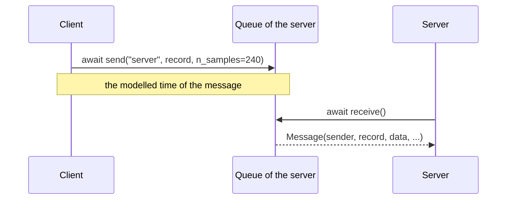

# Messaging

Entities exchange versions of their models, and any data attached to them, with
three methods of [Entity][flypse.federation.entity.Entity].



## Send and receive

[send][flypse.federation.entity.Entity.send] delivers a message to one or more
entities, and [bcast][flypse.federation.entity.Entity.bcast] to all the neighbours.
Keyword arguments are attached to the message:

```python
await self.send("server", record, n_samples=len(self.data), loss=loss)
await self.send(["client_0", "client_1"], record)
await self.bcast(record)
```

[receive][flypse.federation.entity.Entity.receive] waits for the next message, a
[Message][flypse.federation.message.Message]:

```python
message = await self.receive()
```

| Attribute | Holds |
| --- | --- |
| `sender` | The identifier of the sender |
| `record` | The [version](versions.md) sent, or None |
| `data` | The data attached, such as `{"n_samples": 240, "loss": 0.04}` |
| `sent_at` | When the sender sent it |
| `received_at` | When it reached the device of the recipient, before waiting in its queue |
| `size` | Its size on the wire, in bytes |

A record holds its parameters as one flat, read-only vector, so it is sized correctly
on the wire and cannot be altered by the entities sharing it.

Attach what the sender knows, such as how much data it trained on. How much a contribution
weighs is decided by [whoever aggregates](../strategies/weighting.md), when it aggregates.

## Control messages

A message without a model carries only its data, and its `record` is None:

```python
await self.bcast(stop=True)
```

## Receive from a given sender

`receive` returns messages in the order they arrived, whoever sent them. With `source`, it
returns the oldest message of that entity, and leaves the others in the queue:

```python
messages = [await self.receive(source=peer) for peer in sorted(peers)]
```

This keeps a round to the messages of that round, even when one neighbour is a round ahead of
another. Messages from the same sender keep their order, as long as the sender awaits each
`send`.

Nor should the result of an aggregation depend on who arrived first. Floating-point
rounding makes a sum follow the order of its terms, so when receiving from anyone, sort the
messages before combining them:

```python
messages.sort(key=lambda message: message.sender)
```

## Timeouts

`receive` waits for as long as it takes unless given a `timeout`, in seconds.
It then raises `TimeoutError`, and a message arriving later stays in the queue
for the next call:

```python
try:
    message = await self.receive(timeout=2.0)
except TimeoutError:
    ...
```

With `timeout=0`, it returns a message already in the queue, or raises at once.

## What a message costs { #message-cost }

Awaiting `send` or `bcast` takes the modelled time of the message, computed
from the route it follows through the infrastructure:

```text
cost = sum over the devices of processing_time / 1000 +
       sum over the links of (bytes * 8e-6 / bandwidth + latency / 1000)
```

with `processing_time` and `latency` in milliseconds, and `bandwidth` in
megabits per second, for a cost in seconds. The devices and the links are those along
the route, both ends included. Entities on the same device exchange messages at no
cost.

The size of the message comes from the size of the record, so a bigger model
really does take longer to send. To several recipients, the wait lasts as long as
the slowest of them, so one slow link stalls the sender. When each recipient gets a message
of its own, send them at the same time:

```python
import asyncio

await asyncio.gather(
    *(self.send(client, record) for client, record in records.items())
)
```

The stamps of a message measure what it took, the modelled cost and the real transport of
your machine together, with no bookkeeping of your own:

```python
transit = message.received_at - message.sent_at
self.report(sender=message.sender, seconds=transit, bytes=message.size)
```

## When a message cannot be delivered

A message is lost when its recipient is not a neighbour, when the infrastructure has no path
to it, or when it is not running: not deployed, or ended by a failed `step`.

!!! warning

    The sender is not told: `send` and `bcast` return, and the `step` goes on. An entity
    then waiting for an answer waits forever, unless it uses a `timeout`.

A `bcast` reaches the neighbours it can, whatever happens to the others.

!!! note "See also"

    - [Versions](versions.md)
    - [Decentralised federated averaging](../examples/decentralized.md)
    - [Heterogeneity](../advanced/heterogeneity.md)
