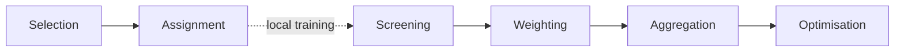

# Strategies

A strategy is a building block an entity calls inside its own
[step](../concepts/entities.md). An entity that aggregates what others send, such as a
server, a group aggregator or a peer, makes a few separate decisions at every round, and
[flypse.strategies][] has one module for each of them.

Use these pages once you can [run a federation](../getting-started/first-federation.md)
and want to change how it learns.

## The decisions of a round



<div class="grid cards" markdown>

-   :octicons-people-16: **[Selection](selection.md)**

    ---

    Whom to engage: which of the candidates are contacted at all.

-   :octicons-tasklist-16: **[Assignment](assignment.md)**

    ---

    What each selected entity is asked to do, along with the model it is sent.

-   :octicons-filter-16: **[Screening](screening.md)**

    ---

    Which of the received contributions to use, and in which groups.

-   :octicons-law-16: **[Weighting](weighting.md)**

    ---

    How much each contribution counts, for everyone or for a given recipient.

-   :octicons-git-merge-16: **[Aggregation](aggregation.md)**

    ---

    How the contributions combine into one vector.

-   :octicons-graph-16: **[Optimisation](optimization.md)**

    ---

    How the result changes the model of the entity.

-   :octicons-workflow-16: **[Compose an algorithm](algorithms.md)**

    ---

    Build FedAdam, FedBuff, a Byzantine-robust server or a gossip peer out of these
    decisions.

</div>

A decision you do not need is a decision you skip: federated averaging screens nothing,
and a peer of a ring selects nobody, as it talks to all of its neighbours.

## What strategies work on

Strategies are plain functions, and a few small classes when there is a state to keep
between rounds. They know nothing of rounds, messages in flight or entities, so any
protocol can use them:

- a **vector** is a flat numpy array over the coordinates of a model: the parameters of a
  received version, `message.record.parameters`, or its difference from the version it
  was generated from,
- **weights** are one number per contribution, in the same order as the vectors,
- **positions** are the indices of the contributions a filter keeps, so that vectors,
  senders and weights stay aligned.

A whole round is then a few lines of the `step` of a server:

```python
from flypse.strategies import aggregation, selection, weighting

async def step(self):
    selected, _ = selection.uniform(await self.get_neighbors(), 10, self.rng)
    await self.send(selected, self.model.versions[-1])
    messages = [await self.receive(source=client) for client in selected]

    weights = weighting.normalise(weighting.by_samples(messages))
    average = aggregation.mean([m.record.parameters for m in messages], weights)
    self.model.update_version(average, "global")
```

Strategies have no names at the top of the package: import the module of a decision and
call its members through it, so that the code says which decision it makes.

## State and randomness

A strategy with a state, such as an [optimiser](optimization.md), belongs to the entity:
create it in `__init__`, and it follows the entity when it is
[deployed again](../concepts/system.md#placement-reset).

A strategy with a random choice takes the generator to draw from. Pass `self.rng`, or
`self.np_rng` where a numpy generator is asked for, so that the choice is
[reproducible](../advanced/reproducibility.md).

!!! info "Important"

    Floating-point sums depend on their order, and messages arrive in a different order at
    every run. Receive from each sender in turn, as above, or sort the messages by sender
    before combining them.

!!! note "See also"

    - [Compose an algorithm](algorithms.md)
    - [Models](../concepts/models.md)
    - [Versions](../concepts/versions.md)
